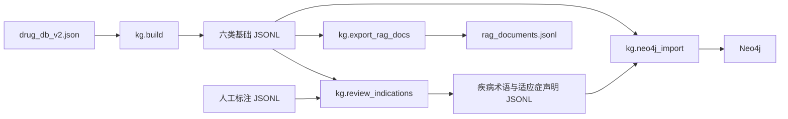
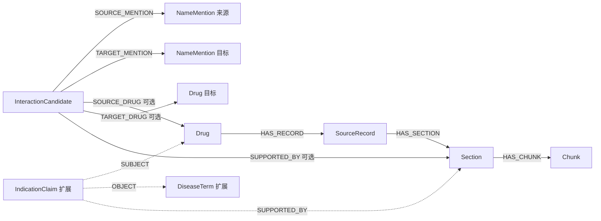

# 药品图谱实体、关系与属性说明

检查日期：2026-10-28（Asia/Shanghai）。检查范围为当前项目中的药品图谱数据文件、原始药品与疾病实体数据、药品分类映射，以及对应的构建、人工标注和 Neo4j 导入代码。本文按实体类型、关系类型及字段列出完整结构；数量来自本次逐行读取，不将每个实例展开为长表。

## 1. 检查结论与阅读约定

- 当前 `data/kg_output/` 有 **6 类实体、260,692 个节点记录**，依照导入代码可还原 **8 种关系类型、278,112 条有向边**。这些是本地文件推算值，未连接 Neo4j，不能据此认定数据库已完成导入。
- 代码总共支持 **8 类实体、10 种关系类型、11 种起点—关系—终点组合**。增加的 `DiseaseTerm`、`IndicationClaim` 及相关关系需经过人工标注流程，当前对应输出文件不存在。
- JSONL 每行保存一个节点记录，关系通过外键保存，导入时转换成 Neo4j 边。当前没有单独的 `edges.jsonl` 或三元组文件。
- **所有 Neo4j 边均未设置边属性**。风险、证据、审核等业务属性存放于 `InteractionCandidate`、`IndicationClaim` 等节点；外键用来建边，多数不会保留为 Neo4j 节点属性。
- 原始目录还包含疾病、药品属性、药品分类等关系信息；当前构建器只读取 `drug_db_v2.json`，其余数据尚未接入这套图谱。
- 本次发现一处原始药名与图谱药名不一致，以及源文件快照哈希不一致，详见第 10 节。

本文中，“当前”指本地已有文件；“扩展”指代码已实现但文件尚未生成；“原始字段关联”指原始 JSON 中的嵌套、数组或文本信息，不代表已存在同名 Neo4j 关系。`string`、`integer`、`boolean` 分别表示字符串、整数、布尔值。

## 2. 文件清单与数据流

以下路径均相对于项目根目录 `RAG_project/`。`RAW/` 在本文中仅为 `data/data/raw/drug_db/MedGraphRAG-Drug-DB/` 的简写。

### 2.1 当前图谱及扩展输出

| 文件 | 对应实体/内容 | 当前数量或状态 |
| --- | --- | ---: |
| `data/kg_output/drugs.jsonl` | `Drug`，药品名称级实体 | 12,043 |
| `data/kg_output/source_records.jsonl` | `SourceRecord`，来源记录 | 12,043 |
| `data/kg_output/sections.jsonl` | `Section`，来源字段章节 | 106,985 |
| `data/kg_output/chunks.jsonl` | `Chunk`，章节文本块 | 108,327 |
| `data/kg_output/mentions.jsonl` | `NameMention`，名称/类别提及 | 7,978 |
| `data/kg_output/interaction_candidates.jsonl` | `InteractionCandidate`，候选相互作用 | 13,316 |
| `data/kg_output/build_report.json` | 构建参数、计数、源文件哈希，schema 为 `0.1.0` | 已存在 |
| `data/kg_output/disease_terms.jsonl` | 扩展：`DiseaseTerm` | 文件不存在 |
| `data/kg_output/indication_claims.jsonl` | 扩展：`IndicationClaim` | 文件不存在 |
| `data/kg_output/review_report.json` | 扩展：人工标注匹配报告 | 文件不存在 |
| `data/kg_output/rag_documents.jsonl` | 由 Chunk 导出的检索文档，不是新增实体类型 | 文件不存在 |

### 2.2 原始数据、报告与技术样例

| 文件 | 实际存储格式 | 内容及规模 | 与当前图谱的关系 |
| --- | --- | --- | --- |
| `RAW/drug_db_v2.json` | JSON 对象 | `drugs` 12,043 条；`interactions` 13,316 条 | 当前构建器的源数据格式 |
| `RAW/drug_db.json` | JSON 对象 | `drugs` 12,474 条；`interactions` 13,316 条 | 清洗前版本，不与 v2 叠加计数 |
| `RAW/drug.json` | **JSONL**，虽然扩展名为 `.json` | 17,496 条、17,019 个不同中心词、117 种字段 | 原始药品及属性资料；当前未导入 |
| `RAW/medical.json` | **JSONL**，虽然扩展名为 `.json` | 8,808 条、8,807 个不同疾病名、24 种字段 | 原始疾病及关联资料；当前未导入 |
| `RAW/drug_categories_chinese.json` | JSON 对象 | 10 个一级分类、132 个二级分类、4,314 个药名归属项 | 中药用途分类；当前未导入 |
| `RAW/drug_categories_western.json` | JSON 对象 | 21 个一级分类、135 个二级分类、4,735 个药名归属项 | 化学药用途分类；当前未导入 |
| `data/reports/full_build_report.json` | JSON 对象 | 历史全量构建报告 | 与当前 `build_report.json` 的计数及源快照哈希相同 |
| `data/reports/quality_report.json` | JSON 对象 | 历史字段覆盖率、风险与端点匹配统计 | 辅助说明，不作为新节点或边 |
| `data/reports/integrity_report.json` | JSON 对象 | 历史引用和偏移校验，报告错误数为 0 | 不包含本次发现的源文件快照差异 |
| `data/kg/demo/mock_drug_db.json` | JSON 对象 | 2 个虚构药名、1 条候选相互作用 | 技术样例，不计入生产图谱 |
| `data/kg/demo/human_annotations.example.jsonl` | JSONL | 1 条虚构适应症人工标注 | 标注输入格式样例 |

教材原文 `RAG知识库/*.md`、其处理缓存 `data/temp/md_*.json` 及教材持久化图谱 `data/chroma_db/knowledge_graph_*.sqlite3` 均不纳入本文。`data/kg/tests/test_build.py` 中的内嵌虚构实体仅用于测试。

### 2.3 定义和转换逻辑

| 代码 | 职责 |
| --- | --- |
| `data/kg/build.py` | 原始药品库 → 六类 JSONL；定义章节字段、ID、分块、相互作用证据匹配 |
| `data/kg/neo4j_import.py` | 八类节点的唯一约束、节点属性写入及十种边类型；默认 dry-run |
| `data/kg/review_indications.py` | 将符合要求的人工适应症标注转成疾病术语和证据声明 |
| `data/kg/export_rag_docs.py` | 关联 Chunk、Section、SourceRecord、Drug，导出检索文本及元数据 |
| `data/kg/profile.py` | 源数据字段、风险、名称匹配、证据覆盖统计 |



## 3. 完整实体类型与节点属性

下面列出全部 JSONL 字段。“节点属性”表示导入后保留在该 Neo4j 节点上；“建边外键”表示只用来查找其他节点。每类实体的 `id` 都是字符串主键，导入代码为八类节点分别建立 `id` 唯一约束。

### 3.1 Drug：药品名称级实体

文件：`drugs.jsonl`；Neo4j 标签：`Drug`。

| 字段 | 类型 | 存储位置 | 含义 |
| --- | --- | --- | --- |
| `id` | string | 节点属性 | 药名生成的确定性 ID，前缀 `drug_` |
| `name` | string | 节点属性 | 源数据 `drugs` 字典中的完整药名键 |
| `entity_scope` | string | 节点属性 | 当前全部为 `dataset_drug_name_not_approved_product`，表示数据集名称级实体 |

同名实体不包含剂量、生产企业、批准文号等注册产品维度，不能据此认定一个节点对应一个已批准的药品产品。

### 3.2 SourceRecord：来源记录

文件：`source_records.jsonl`；标签：`SourceRecord`。

| 字段 | 类型 | 存储位置 | 含义 |
| --- | --- | --- | --- |
| `id` | string | 节点属性 | 来源记录 ID，前缀 `sourcerecord_` |
| `drug_id` | string | 建边外键 | 指向 `Drug.id`，生成 `Drug → HAS_RECORD → SourceRecord` |
| `source_url` | string | 节点属性 | 原始 `source` URL；文本来源追踪地址 |
| `record_sha256` | string | 节点属性 | 单条原始记录值经规范化 JSON 序列化后的完整 SHA-256 |
| `snapshot_sha256` | string | 节点属性 | 构建时整个输入文件的字节级 SHA-256 |
| `dataset` | string | 节点属性 | 当前为 `MedGraphRAG-Drug-DB drug_db_v2.json` |
| `version_status` | string | 节点属性 | 当前为 `unknown`，说明书版本未确认 |
| `authority_status` | string | 节点属性 | 当前为 `third_party_unverified`，第三方资料未进行权威核验 |
| `license_status` | string | 节点属性 | 当前为 `not_assessed_for_redistribution`，再分发授权未评估 |

`record_sha256` 不包含外层药名键；只改变药名而保留记录值时，这个哈希可能保持相同。源文件快照哈希还受换行、缩进、编码等字节变化影响。

### 3.3 Section：字段章节

文件：`sections.jsonl`；标签：`Section`。

| 字段 | 类型 | 存储位置 | 含义 |
| --- | --- | --- | --- |
| `id` | string | 节点属性 | 来源记录 ID 和字段名生成，前缀 `section_` |
| `record_id` | string | 建边外键 | 指向 `SourceRecord.id`，生成 `HAS_SECTION` |
| `field` | string | 节点属性 | 原始字段键，完整列表见第 5 节 |
| `title` | string | 节点属性 | 字段对应的中文标题 |
| `text` | string | 节点属性 | 经过 `text_of()` 处理的章节文本 |
| `placeholder` | boolean | 节点属性 | 是否整段仅为“尚不明确”等缺少信息的占位文本 |

空字段不生成章节。占位章节保留，但并不因此成为有效事实。`text_of()` 将字符串去除首尾空白，将列表中的非空项递归转成文本并用换行连接；`None` 变成空字符串，其他值转成 JSON 文本。

### 3.4 Chunk：检索文本块

文件：`chunks.jsonl`；标签：`Chunk`。

| 字段 | 类型 | 存储位置 | 含义 |
| --- | --- | --- | --- |
| `id` | string | 节点属性 | 章节 ID、起止偏移生成，前缀 `chunk_` |
| `section_id` | string | 建边外键 | 指向 `Section.id`，生成 `HAS_CHUNK` |
| `field` | string | 节点属性 | 冗余保存所属章节的原始字段键 |
| `start` | integer | 节点属性 | 在所属 `Section.text` 中的起始字符下标 |
| `end` | integer | 节点属性 | 结束字符下标，不包含该位置 |
| `text` | string | 节点属性 | 应严格等于 Python 表达式 `Section.text[start:end]` |

偏移按 Python 字符串的 Unicode 码点计算，采用左闭右开区间 `[start, end)`，不是 UTF-8 字节偏移，也不是原始 JSON 文件偏移。默认块长 800、重叠 90；优先在块后 40% 范围内的句号、分号、感叹号、问号或换行处切分。相邻 Chunk 可以重叠。

### 3.5 NameMention：名称或类别提及

文件：`mentions.jsonl`；标签：`NameMention`；ID 使用的内部种类名为 **`Mention`**，因此前缀是 `mention_`。

| 字段 | 类型 | 存储位置 | 含义 |
| --- | --- | --- | --- |
| `id` | string | 节点属性 | 由端点提及文本生成，同名提及在文件内去重 |
| `name` | string | 节点属性 | 候选相互作用端点的原始名称，可能是具体药名、药物类别或其他提及 |
| `semantic_status` | string | 节点属性 | 当前全部为 `unresolved_name_or_category`，尚未完成语义消歧 |

即使同名端点恰好能匹配 `Drug`，也仍保留 NameMention；代码不会创建 `NameMention → Drug` 的映射边，而是从候选节点另行连接 Drug。

### 3.6 InteractionCandidate：候选相互作用

文件：`interaction_candidates.jsonl`；标签：`InteractionCandidate`。

| 字段 | 类型 | 存储位置 | 含义 |
| --- | --- | --- | --- |
| `id` | string | 节点属性 | 由来源名、目标名和 `note` 生成，前缀 `interactioncandidate_` |
| `source_name` | string | 节点属性 | 原始 `pair[0]` 去除首尾空白后的名称 |
| `target_name` | string | 节点属性 | 原始 `pair[1]` 去除首尾空白后的名称 |
| `source_mention_id` | string | 建边外键 | 指向来源端 `NameMention.id`，生成 `SOURCE_MENTION` |
| `target_mention_id` | string | 建边外键 | 指向目标端 `NameMention.id`，生成 `TARGET_MENTION` |
| `source_drug_id` | string | 建边外键 | 精确匹配来源药名时保存 `Drug.id`；未匹配为 `""` |
| `target_drug_id` | string | 建边外键 | 精确匹配目标药名时保存 `Drug.id`；未匹配为 `""` |
| `risk_label_in_source` | string | 节点属性 | 原始 `risk` 标签，空值回退为 `unknown`；分布见第 6 节 |
| `note` | string | 节点属性 | 原始候选说明文本，经 `text_of()` 处理 |
| `evidence_section_id` | string | 建边外键 | 精确定位到的来源章节 ID；未找到为 `""` |
| `evidence_field` | string | 节点属性 | 证据来自 `drug_interactions` 或 `warnings`；未找到为 `""` |
| `evidence_char_start` | integer | 节点属性 | `note` 在证据章节文本中首次出现的起点；无证据为 `-1` |
| `evidence_char_end` | integer | 节点属性 | 首次匹配片段终点，不含该位置；无证据为 `-1` |
| `evidence_status` | string | 节点属性 | 有逐字证据为 `exact_quote_found`，否则为 `unverified` |
| `clinical_status` | string | 节点属性 | 当前全部为 `not_validated`，未完成临床验证 |

证据只在**来源药品**的章节中查找：优先 `drug_interactions`，其次 `warnings`。只有完整非空 `note` 是章节文本的逐字子串，才建立 `SUPPORTED_BY`。这个匹配不依赖目标端是否能匹配 Drug，也不代表医学结论正确。`SOURCE_*`、`TARGET_*` 只表达原始记录端点角色，不足以推断临床相互作用的因果或对称性；代码不自动添加反向关系。

### 3.7 DiseaseTerm：人工标注的疾病术语（扩展）

预期文件：`disease_terms.jsonl`；标签：`DiseaseTerm`。当前文件不存在，不等同于 `medical.json` 中的 8,808 条疾病记录。

| 字段 | 类型 | 存储位置 | 含义 |
| --- | --- | --- | --- |
| `id` | string | 节点属性 | 根据标注疾病名生成，前缀 `diseaseterm_` |
| `name` | string | 节点属性 | 人工标注的疾病术语文本 |
| `normalization_status` | string | 节点属性 | 固定为 `not_mapped_to_standard_terminology`，尚未映射到标准术语体系 |

### 3.8 IndicationClaim：适应症文本证据声明（扩展）

预期文件：`indication_claims.jsonl`；标签：`IndicationClaim`。当前文件不存在。

| 字段 | 类型 | 存储位置 | 含义 |
| --- | --- | --- | --- |
| `id` | string | 节点属性 | 根据章节 ID、疾病名和引文生成，前缀 `indicationclaim_` |
| `drug_id` | string | 建边外键 | 主体药品，通过 `SUBJECT` 连接 |
| `disease_id` | string | 建边外键 | 客体疾病，通过 `OBJECT` 连接 |
| `section_id` | string | 建边外键 | `field=indication` 的证据章节，通过 `SUPPORTED_BY` 连接 |
| `predicate` | string | 节点属性 | 固定为 `INDICATION_TEXT_MENTIONS`，表示适应症文本提及疾病；不是边类型 |
| `evidence_quote` | string | 节点属性 | 人工提供且与适应症文本逐字匹配的引文 |
| `char_start` | integer | 节点属性 | 引文在 `Section.text` 中首次出现的起点 |
| `char_end` | integer | 节点属性 | 引文终点，采用 `[char_start, char_end)` |
| `review_status` | string | 节点属性 | 输出固定为 `human_checked_text_match` |
| `clinical_status` | string | 节点属性 | 固定为 `not_validated` |

## 4. 全部图关系：方向、外键、数量与基数

下表逐项列出导入代码支持的全部关系组合。数量为当前 JSONL 在空库、引用有效并完整执行导入时可产生的边数；“0（缺文件）”不是对已有 Neo4j 数据的查询结果。每一行的**边属性均为空**。

| 起点 | 关系类型 | 终点 | 外键与生成条件 | 当前可生成边数 |
| --- | --- | --- | --- | ---: |
| `Drug` | `HAS_RECORD` | `SourceRecord` | `source_records.drug_id = Drug.id` | 12,043 |
| `SourceRecord` | `HAS_SECTION` | `Section` | `sections.record_id = SourceRecord.id` | 106,985 |
| `Section` | `HAS_CHUNK` | `Chunk` | `chunks.section_id = Section.id` | 108,327 |
| `InteractionCandidate` | `SOURCE_MENTION` | `NameMention` | `source_mention_id`；两端提及节点须均存在 | 13,316 |
| `InteractionCandidate` | `TARGET_MENTION` | `NameMention` | `target_mention_id`；两端提及节点须均存在 | 13,316 |
| `InteractionCandidate` | `SOURCE_DRUG` | `Drug` | `source_drug_id` 对应节点存在时 | 12,103 |
| `InteractionCandidate` | `TARGET_DRUG` | `Drug` | `target_drug_id` 对应节点存在时 | 66 |
| `InteractionCandidate` | `SUPPORTED_BY` | `Section` | `evidence_section_id` 对应节点存在时 | 11,956 |
| `IndicationClaim` | `SUBJECT` | `Drug` | 扩展：`drug_id` | 0（缺文件） |
| `IndicationClaim` | `OBJECT` | `DiseaseTerm` | 扩展：`disease_id` | 0（缺文件） |
| `IndicationClaim` | `SUPPORTED_BY` | `Section` | 扩展：`section_id`；主体、客体、证据须均存在 | 0（缺文件） |

当前 8 种边类型的合计为 **278,112**。扩展复用 `SUPPORTED_BY`，所以共有 11 种端点组合、10 种不同边类型。

基数由构建文件约定，数据库只建立了节点 ID 唯一约束，没有建立关系基数约束：

- 当前快照中，Drug 与 SourceRecord 一对一；记录版本变化后，同一个 Drug 可以有多个 SourceRecord。
- 一个 SourceRecord 可有多个 Section，本构建器每个记录每个非空字段至多生成一个 Section；一个 Section 可有多个 Chunk。
- 每个候选恰好连接一个来源提及、一个目标提及；分别至多连接一个来源 Drug、一个目标 Drug、一个证据 Section。同一个提及、药品或章节可被多个候选复用。
- 每个扩展 IndicationClaim 对应一个主体 Drug、一个客体 DiseaseTerm 和一个证据 Section；同一药品或疾病可参与多个声明。



目前没有定义 `DRUG_INTERACTS_WITH`、药品直接治疗疾病、药品直接禁用于某人群、药品直接含有成分、药品直接属于分类等 Neo4j 边。相应原文只保存在章节或未接入的原始文件中。

## 5. 全部章节字段与原始药品字段映射

`drug_db.json` 和 `drug_db_v2.json` 都是 `{"drugs": {药名: 记录值}, "interactions": [...]}`。两版的药品记录都包含下表 11 个业务字段及一个 `source` 字段；`source` 为字符串，转为 `SourceRecord.source_url`，不生成 Section。

| 原始字段 / `Section.field` | `Section.title` | 原始值类型 | 当前章节数 | 其中占位数 | 字段语义 |
| --- | --- | --- | ---: | ---: | --- |
| `indication` | 适应症 | string | 11,654 | 0 | 适应症原文，不自动提取获批治疗关系 |
| `contraindications` | 禁忌 | string[] | 8,453 | 1,625 | 禁忌记录，可能混有慎用描述 |
| `warnings` | 注意事项 | string | 10,511 | 30 | 注意事项，可作为候选相互作用的次选证据 |
| `composition` | 成分 | string | 11,102 | 0 | 成分文本，未拆分为成分实体 |
| `dosage` | 用法用量 | string | 11,316 | 1 | 用法用量原文 |
| `adverse_reactions` | 不良反应 | string | 8,331 | 2,896 | 不良反应原文，未拆分为症状实体 |
| `drug_interactions` | 药物相互作用 | string | 7,511 | 685 | 相互作用原文，候选证据优先在此匹配 |
| `storage` | 贮藏 | string | 9,523 | 0 | 储存条件原文 |
| `validity` | 有效期 | string | 7,061 | 0 | 有效期原文，不保证已转为结构化期限 |
| `approval_numbers` | 批准文号原始记录 | string[] | 12,043 | 0 | 可混合药名、规格、厂家和批准文号，未拆成注册产品 |
| `manufacturers` | 生产企业原始记录 | string[] | 9,480 | 0 | 可含整段产品描述，未拆分企业实体 |
| **合计** | | | **106,985** | **5,237** | |

占位判定：先去除文本两端的 `。．；,，;` 和空格，再与 `尚不明确`、`尚不清楚`、`不详`、`暂无`、`无资料`、`未见报道`、`未提供` 做整段精确比较；不做包含匹配或医学语义判断。

原始 `interactions` 数组的全部字段如下：

| 字段 | 类型 | 含义与转换 |
| --- | --- | --- |
| `pair` | string[2] | `[来源名, 目标名]`；转换为两个名称、两个提及外键及可选药品外键 |
| `risk` | string | 来源标签，转换为 `risk_label_in_source` |
| `note` | string | 候选说明，保存为 `note`，并用于匹配来源章节 |

构建器会跳过非字典候选、长度不为 2 的 `pair` 或空端点名称。默认抽样 300 个药名、随机种子 42；抽样时保留至少一端在选中药名集合中的候选，未入选端点不创建 Drug，仍可保留 NameMention。当前构建报告的 `sample_limit=0`，为全量构建。

## 6. 相互作用属性的当前分布

### 6.1 风险、证据与临床状态

| 属性 | 当前取值 | 数量 | 解释 |
| --- | --- | ---: | --- |
| `risk_label_in_source` | `high` | 1,728 | 上游标为高风险，未独立验证 |
| `risk_label_in_source` | `medium` | 2,840 | 上游标为中等风险，未独立验证 |
| `risk_label_in_source` | `none` | 39 | 上游标签为 none，不能直接理解为已证实安全 |
| `risk_label_in_source` | `unknown` | 8,709 | 上游风险未知或空值回退 |
| `evidence_status` | `exact_quote_found` | 11,956 | 在来源章节逐字找到 note |
| `evidence_status` | `unverified` | 1,360 | 未定位到逐字证据，无 `SUPPORTED_BY` |
| `clinical_status` | `not_validated` | 13,316 | 全部候选均未经临床验证 |

11,956 个逐字证据中，11,950 个来自 `drug_interactions`，6 个来自 `warnings`。风险标签是开放字符串，代码未通过枚举限制其取值；上表只列当前实际出现的值。

### 6.2 两端药名精确匹配

| 来源端匹配 Drug | 目标端匹配 Drug | 候选数 |
| --- | --- | ---: |
| 是 | 否 | 12,047 |
| 否 | 否 | 1,203 |
| 是 | 是 | 56 |
| 否 | 是 | 10 |
| **合计** | | **13,316** |

因此 `SOURCE_DRUG` 为 12,047 + 56 = 12,103 条，`TARGET_DRUG` 为 56 + 10 = 66 条。不能将 13,316 条候选理解为 13,316 条双方药品均已解析的实体关系。未匹配端点可能是药物类别、别名或其他字符串；目前没有别名与类别解析器。

## 7. 人工疾病标注与声明生成规则

标注输入的全部字段为：

| 字段 | 类型 | 生成要求 |
| --- | --- | --- |
| `drug_name` | string | 去除首尾空白后，必须精确匹配当前 `drugs.jsonl` 的药名 |
| `disease_name` | string | 非空，且必须是引文的逐字子串 |
| `evidence_quote` | string | 非空，必须在该药品某一条 `indication` 章节中逐字出现 |
| `review_status` | string | 只有值为 `human_checked` 的输入才参与处理；其他状态被跳过 |

程序要求引文匹配到的章节数恰好为 1；同一章节内即使引文重复出现，也只取第一次的位置。有效结果按确定性声明 ID 去重，疾病术语按疾病名去重。输出审核状态变为 `human_checked_text_match`，临床状态仍为 `not_validated`。缺少药品、空字段、疾病不在引文中或无法唯一匹配章节的输入写入审核报告的拒绝列表。

`kg.review_indications` 会重写疾病术语、声明和审核报告。`kg.build` 在重建基础数据时会删除这三个旧审核输出文件；人工标注原文件需要单独保留。它们不会自动从 `medical.json` 生成，也不代表监管批准适应症。

## 8. 尚未接入图谱的原始实体与关系

### 8.1 中药与化学药分类映射

两份分类文件的结构均为：

```text
categories
└── 一级分类名
    └── 二级分类名
        └── [药名字符串, ...]
```

原始存储包含两种关联：**一级分类 → 二级分类**、**二级分类 → 药名提及**。没有显式 ID、关系类型名或关系属性；文件名区分分类体系，完整路径区分类别，数组项不是注册产品 ID。

| 文件 | 一级类别 | 二级类别 | 一级→二级关联项 | 二级→药名关联项 | 不同药名数 |
| --- | ---: | ---: | ---: | ---: | ---: |
| `drug_categories_chinese.json` | 10 | 132 | 132 | 4,314 | 3,961 |
| `drug_categories_western.json` | 21 | 135 | 135 | 4,735 | 4,698 |

中药一级分类完整列表：内科用药、外科用药、儿科用药、妇科用药、皮肤科用药、骨伤科用药、耳鼻喉科用药、口腔科用药、眼科用药、民族药。

化学药一级分类完整列表：抗生素药物、抗寄生虫、抗肿瘤药物、镇痛解热、神经系统、治疗精神障碍用药、心血管系统、呼吸系统、消化系统、血液系统、泌尿系统、激素及影响内分泌药、维生素 矿物质 肠营养药、解毒药、诊断用药、计划生育用药、皮肤科、眼科、妇产科、骨科、其他类药品。

按**当前原始 v2 字典**做药名字符串精确匹配，中药有 2,753 个归属项命中、1,561 个未命中；化学药有 4,522 个命中、213 个未命中。这里统计的是数组归属项，不是去重药名数，也不是已经创建的 Drug 边。同一药名可以属于多个类别；仅有分类文本不足以确认分类医学正确性。

### 8.2 medical.json：疾病资料及全部字段关联

这是逐行 JSON 的疾病资料库，共 8,808 条记录，`_id.$oid` 均不同；疾病名称只有 8,807 个不同值，`胎膜早破` 出现两次。因此疾病名不能直接作为该文件无冲突的唯一 ID。

下表列出全部 **24 个字段**。数组关联项是逐条数组长度的合计，包含可能重复的名称；它们尚未转为当前图谱的节点或边。`recommand_*` 为原文件拼写，不能在读取时擅自改成 `recommend_*`。

| 字段 | 类型 | 有字段的记录数 | 数组关联项数 | 含义/关联 |
| --- | --- | ---: | ---: | --- |
| `_id` | object | 8,808 | — | 原始记录标识对象，内含 MongoDB 扩展 JSON 字段 `$oid` |
| `name` | string | 8,808 | — | 疾病名称，作为本行关系的中心名称 |
| `desc` | string | 8,808 | — | 疾病描述文本 |
| `category` | string[] | 8,808 | 25,590 | 疾病 → 类别名称数组；原始分类关联 |
| `prevent` | string | 8,808 | — | 预防说明文本 |
| `cause` | string | 8,808 | — | 病因说明文本，未结构化为因果边 |
| `symptom` | string[] | 8,808 | 54,710 | 疾病 → 症状提及 |
| `yibao_status` | string | 8,807 | — | 医保状态原始字符串 |
| `get_prob` | string | 8,806 | — | 患病概率/发生率原始字符串 |
| `get_way` | string | 8,806 | — | 传播方式原始字符串 |
| `acompany` | string[] | 8,807 | 12,052 | 疾病 → 伴随疾病提及 |
| `cure_department` | string[] | 8,807 | 16,783 | 疾病 → 就诊/治疗科室提及 |
| `cure_way` | string[] | 8,806 | 21,049 | 疾病 → 治疗方式文本项 |
| `cure_lasttime` | string | 8,806 | — | 治疗周期原始字符串 |
| `cured_prob` | string | 8,806 | — | 治愈概率原始字符串 |
| `cost_money` | string | 8,807 | — | 费用说明原始字符串 |
| `check` | string[] | 8,808 | 39,531 | 疾病 → 检查项目提及 |
| `recommand_drug` | string[] | 8,808 | 59,467 | 疾病 → 推荐药品名称提及 |
| `drug_detail` | string[] | 8,808 | 163,313 | 疾病 → 药品详情文本，可能含品牌与厂家 |
| `easy_get` | string | 8,804 | — | 易感人群描述字符串 |
| `common_drug` | string[] | 7,645 | 14,656 | 疾病 → 常用药品名称提及 |
| `do_eat` | string[] | 5,576 | 22,258 | 疾病 → 宜食食物提及 |
| `not_eat` | string[] | 5,576 | 22,278 | 疾病 → 忌食食物提及 |
| `recommand_eat` | string[] | 5,576 | 40,267 | 疾病 → 推荐食物/菜谱提及 |

`category` 和 `cure_department` 常含有层级含义，但目前仅为字符串数组，不能假设数组中的所有项已建立了显式父子关系。`drug_detail` 可混合品牌、厂家与括号内通用药名，需要进一步解析；`do_eat`、`not_eat` 和 `recommand_eat` 的原始推荐信息也没有额外证据、风险或审核属性。发生率、治愈率、费用等保留原字符串，未转换为统一数值或单位。

### 8.3 drug.json：药品及相关资料的全部字段关联

这是逐行 JSON 的资料库，共 17,496 条记录：`class=中成药` 5,900 条，`中草药` 1,996 条，`西药` 9,600 条。`中心词` 有 17,019 个不同值，记录数比不同名称多 477，不可按行数直接认定独立实体数。

它没有统一 `id`。`class` 和 `中心词` 为字符串，其余 **115 个字段均为字符串数组**，共 **595,257 个数组值项**。原始字段名就是关联键：`中心词 — 字段名 → 值项文本`。值项可以是实体名、类别、属性值或整段文本，当前没有代码将它们分类成实体或写入 Neo4j。下表列出全部 **117 个字段**，保留不同拼写，例如“成份/组成”“适应症/适应证”“禁忌/禁忌证/用药禁忌”，没有擅自合并。

“记录数”为拥有该字段的记录数；“值项数”为字符串数组元素总数；“不同值项数”在该字段内按完整字符串去重。标量字段后两列为 `—`。

| 字段 | 语义/值项含义 | 记录数 | 值项数 | 不同值项数 |
| --- | --- | ---: | ---: | ---: |
| `class` | 记录大类：中成药、中草药或西药 | 17,496 | — | — |
| `中心词` | 本行中心名称，未设统一实体 ID | 17,496 | — | — |
| `成份` | 成分名称或描述 | 10,885 | 108,178 | 13,914 |
| `分类` | 分类名称 | 10,375 | 15,141 | 1,403 |
| `OTC类型` | 非处方药分类标签 | 9,261 | 10,880 | 2 |
| `规格` | 规格描述 | 5,594 | 5,880 | 2,126 |
| `药品类型` | 药品类型标签 | 7,578 | 11,103 | 23 |
| `适应症` | 适应症名称或文本 | 10,283 | 56,930 | 5,472 |
| `用法用量` | 用法用量描述 | 9,285 | 16,848 | 9,315 |
| `贮藏` | 储存条件描述 | 5,823 | 6,460 | 1,306 |
| `不良反应` | 不良反应名称或描述 | 9,871 | 169,067 | 6,897 |
| `药品监管分级` | 监管分级标签 | 7,712 | 11,494 | 55 |
| `功能主治` | 功能与主治名称或文本 | 4,986 | 42,578 | 13,273 |
| `性状` | 外观或性状描述 | 5,696 | 8,249 | 3,915 |
| `禁忌` | 禁忌对象或描述 | 4,840 | 5,984 | 2,187 |
| `用途分类` | 用途分类名称 | 5,225 | 5,253 | 245 |
| `注意事项` | 注意事项文本 | 6,172 | 26,986 | 10,727 |
| `三级分类` | 三级类别名称 | 1,871 | 2,073 | 142 |
| `适应证` | 适应证名称或文本，原始异写 | 3,979 | 17,285 | 1,340 |
| `药物剂型` | 药物剂型名称或描述 | 4,198 | 6,071 | 4,193 |
| `所属科目` | 所属学科名称 | 4,627 | 5,275 | 19 |
| `一级分类` | 一级类别名称 | 4,660 | 5,312 | 24 |
| `二级分类` | 二级类别名称 | 4,527 | 5,363 | 176 |
| `商品名` | 商品名称 | 1,140 | 1,457 | 1,245 |
| `通用名` | 通用名称 | 1,110 | 1,283 | 921 |
| `出处` | 资料出处 | 367 | 373 | 244 |
| `组成` | 组成成分名称或描述 | 205 | 1,146 | 529 |
| `同义词` | 别名/同义名称 | 439 | 494 | 335 |
| `特殊药品` | 特殊药品管理标签 | 428 | 462 | 5 |
| `英文名称` | 英文名称 | 529 | 632 | 474 |
| `有效期` | 有效期描述 | 2,371 | 2,469 | 134 |
| `拼音` | 拼音名称 | 266 | 269 | 256 |
| `界` | 生物分类：界 | 1,951 | 1,963 | 5 |
| `种` | 生物分类：种 | 1,340 | 1,721 | 1,240 |
| `分布区域` | 产地或分布区域 | 1,754 | 7,402 | 946 |
| `毒性` | 毒性标签或描述 | 1,084 | 1,151 | 81 |
| `目` | 生物分类：目 | 1,908 | 2,130 | 227 |
| `性味` | 中药性味描述 | 1,774 | 5,014 | 101 |
| `纲` | 生物分类：纲 | 1,923 | 2,002 | 81 |
| `门` | 生物分类：门 | 1,923 | 1,971 | 39 |
| `属` | 生物分类：属 | 1,908 | 2,194 | 1,067 |
| `采收时间` | 采收时间描述 | 1,700 | 2,766 | 609 |
| `科` | 生物分类：科 | 1,951 | 2,189 | 376 |
| `入药部位` | 入药部位名称 | 1,888 | 2,200 | 749 |
| `批准文号` | 批准文号原文 | 40 | 46 | 43 |
| `执行标准` | 执行标准名称 | 6 | 6 | 4 |
| `药物相互作用` | 相互作用对象或描述 | 1,246 | 5,200 | 1,313 |
| `警示语` | 警示说明文本 | 8 | 17 | 16 |
| `禁忌证` | 禁忌证名称或文本 | 2,019 | 4,992 | 404 |
| `相关疾病` | 相关疾病提及 | 8 | 77 | 74 |
| `相关症状` | 相关症状提及 | 10 | 44 | 42 |
| `所属分类` | 类别名称 | 7 | 7 | 5 |
| `是否处方药` | 处方药状态标签 | 82 | 82 | 2 |
| `用药禁忌` | 用药禁忌名称或文本 | 20 | 30 | 26 |
| `剂型` | 剂型名称 | 59 | 59 | 14 |
| `是否纳入医保` | 医保纳入状态标签 | 74 | 74 | 2 |
| `族` | 生物分类：族 | 18 | 21 | 20 |
| `拉丁学名` | 拉丁名称 | 22 | 35 | 35 |
| `二名法` | 生物双名名称 | 5 | 6 | 6 |
| `光泽` | 矿物光泽描述 | 9 | 10 | 8 |
| `晶系` | 矿物晶系名称 | 9 | 9 | 6 |
| `颜色` | 颜色描述 | 10 | 16 | 14 |
| `比重` | 比重原文，未统一单位 | 7 | 7 | 7 |
| `透明度` | 透明度描述 | 9 | 9 | 6 |
| `化学式` | 化学式字符串 | 9 | 9 | 9 |
| `分子量` | 分子量原文，未转数值 | 9 | 9 | 9 |
| `条痕` | 矿物条痕描述 | 8 | 8 | 7 |
| `硬度` | 硬度原文 | 7 | 7 | 6 |
| `采集加工` | 采集和加工说明 | 4 | 7 | 5 |
| `操作方法` | 操作步骤或方法 | 8 | 37 | 19 |
| `试剂` | 试剂名称 | 28 | 102 | 77 |
| `临床意义` | 临床意义说明 | 17 | 28 | 27 |
| `检查科目` | 检查学科名称 | 33 | 40 | 5 |
| `正常值` | 正常参考值原文 | 15 | 19 | 16 |
| `原理` | 原理说明 | 13 | 14 | 12 |
| `运动员慎用` | 运动员慎用标签 | 16 | 16 | 2 |
| `预后状况` | 预后描述 | 3 | 6 | 4 |
| `高危因素` | 高危因素提及 | 3 | 38 | 14 |
| `相关导致` | 相关导致对象，保留原键语义 | 2 | 14 | 6 |
| `药物引起的并发症` | 药物相关并发症提及 | 3 | 29 | 12 |
| `影像学检查` | 影像检查项目提及 | 3 | 19 | 11 |
| `检查` | 检查项目提及 | 2 | 18 | 9 |
| `发病年龄` | 发病年龄描述 | 2 | 2 | 1 |
| `临床症状及体征` | 症状与体征提及 | 3 | 67 | 48 |
| `UMLS` | UMLS 相关编码或名称原文 | 3 | 11 | 7 |
| `所属科室` | 科室名称 | 3 | 3 | 2 |
| `并发症` | 并发症提及 | 3 | 14 | 8 |
| `ICD-10` | ICD-10 编码原文 | 3 | 9 | 5 |
| `发病部位` | 发病部位名称 | 3 | 3 | 2 |
| `相关转化` | 转化对象提及，保留原键语义 | 2 | 2 | 1 |
| `治疗方案` | 治疗方案名称或描述 | 3 | 5 | 3 |
| `病理分型` | 病理分型名称 | 3 | 20 | 15 |
| `发病率` | 发病率原文 | 3 | 3 | 2 |
| `辅助治疗` | 辅助治疗名称或描述 | 3 | 36 | 20 |
| `实验室检查` | 实验室检查项目提及 | 3 | 29 | 15 |
| `药物治疗` | 治疗药物提及 | 3 | 49 | 28 |
| `辅助检查` | 辅助检查项目提及 | 3 | 8 | 5 |
| `鉴别诊断` | 鉴别诊断对象提及 | 3 | 83 | 39 |
| `病因` | 病因提及或描述 | 3 | 10 | 7 |
| `术后信息` | 术后信息文本 | 1 | 1 | 1 |
| `治疗引起的并发症` | 治疗相关并发症提及 | 1 | 2 | 2 |
| `预防` | 预防措施文本 | 1 | 1 | 1 |
| `内窥镜检查` | 内窥镜检查项目提及 | 1 | 1 | 1 |
| `标准住院时间` | 标准住院时长原文 | 1 | 1 | 1 |
| `选择治疗方案的依据` | 治疗方案选择依据 | 1 | 1 | 1 |
| `发病机制` | 发病机制描述 | 1 | 1 | 1 |
| `组织学检查` | 组织学检查项目提及 | 1 | 2 | 2 |
| `治疗引起的症状` | 治疗相关症状提及 | 1 | 1 | 1 |
| `诊断依据` | 诊断依据文本 | 1 | 3 | 3 |
| `进入路径标准` | 临床路径纳入标准 | 1 | 1 | 1 |
| `术前准备` | 术前准备项目 | 1 | 4 | 4 |
| `出院标准` | 出院标准描述 | 1 | 3 | 3 |
| `遗传因素` | 遗传因素提及 | 1 | 5 | 5 |
| `病理生理` | 病理生理描述 | 1 | 1 | 1 |
| `手术治疗` | 手术方式提及 | 1 | 7 | 7 |
| `筛查` | 筛查项目提及 | 1 | 2 | 2 |
| `病史` | 病史描述 | 1 | 1 | 1 |

低频字段含疾病分型、检查、住院路径等内容，说明不能仅根据文件名或 `class` 值，将每条记录的每个值都解释为标准药品关系。成份、禁忌、不良反应等值也没有证据偏移或审核状态；如后续需要建图，应保留原字段名与原记录位置，完成实体解析后再定义关系类型。

## 9. 标识符、导入及 RAG 元数据约定

### 9.1 确定性 ID

ID 生成代码位于 `kg.build.entity_id()`，规则为：

```python
payload = json.dumps((kind, *parts), ensure_ascii=False,
                     sort_keys=True, separators=(",", ":"))
id = kind.lower() + "_" + sha256(payload.encode("utf-8")).hexdigest()[:24]
```

| 内部 kind / Neo4j 标签 | `parts`，按顺序 |
| --- | --- |
| `Drug` | 药名 |
| `SourceRecord` | Drug ID、来源 URL、原始记录值哈希 |
| `Section` | SourceRecord ID、原始字段键 |
| `Chunk` | Section ID、start、end |
| `Mention` / `NameMention` | 提及文本 |
| `InteractionCandidate` | 来源名、目标名、note |
| `DiseaseTerm` | 疾病名 |
| `IndicationClaim` | Section ID、疾病名、evidence_quote |

节点 ID 中只保留 24 位十六进制摘要；`record_sha256`、`snapshot_sha256` 则保留完整 64 位哈希。候选 ID 不含风险标签；相同端点和 note 即使风险不同，也会映射到同一候选 ID。确定性 ID 配合 `MERGE` 实现相同输入的重复导入复用，但不提供哈希碰撞的数学保证。

### 9.2 文件外键与数据库属性的区别

例如 `source_records.jsonl` 的 `drug_id` 在 Neo4j 中通过 `HAS_RECORD` 表达，查询来源记录时应遍历边，不能假定存在 `SourceRecord.drug_id` 属性。其他建边外键同理。导入顺序为 Drug、SourceRecord、Section、Chunk、NameMention、InteractionCandidate、DiseaseTerm、IndicationClaim。

前置 `MATCH` 未找到父节点会使该行后续创建不发生；候选的 Drug 和证据边使用可选匹配，缺失时只省略该边。导入器默认仅逐行统计，不验证所有外键及业务语义；缺少可选 JSONL 文件按零行处理。

`MERGE` 不会清理旧节点和旧边，`SET` 也不会删除未列出的旧属性。变更源数据、重新审核或只删除本地输出文件后，再导入现有数据库，不保证数据库自动与当前文件完全一致。因此本文的空库推算计数不宜直接用于判断历史数据库中的全部图数据。

### 9.3 RAG 导出字段

导出文档的全部顶层字段为 `id`、`text`、`metadata`；前两者直接使用 Chunk ID 和文本。`metadata` 的全部字段如下：

| 元数据字段 | 来源及含义 |
| --- | --- |
| `drug_name` | `Drug.name` |
| `field` | `Chunk.field` |
| `section_id` | `Section.id` |
| `source_record_id` | `SourceRecord.id` |
| `source_url` | `SourceRecord.source_url` |
| `char_start` | `Chunk.start`，相对于 Section.text |
| `char_end` | `Chunk.end`，相对于 Section.text |
| `version_status` | `SourceRecord.version_status` |

CLI 默认只导出 `indication`、`contraindications`、`warnings`、`composition`、`adverse_reactions`、`drug_interactions` 六类章节，并跳过占位章节。它不会自动导出所有章节，也不会自动将文档写入 ChromaDB。`export_rag()` 函数自身的 `fields=None` 表示不按字段筛选，与 CLI 的默认六字段不同。

## 10. 本次文件检查结果与数据差异

### 10.1 图谱内部检查

逐行读取当前六类 JSONL 后，检查结果如下：

| 检查项 | 结果 |
| --- | --- |
| JSON 记录可解析、各类型节点 ID 不重复 | 通过；六类实体共 260,692 行 |
| 实际行数与当前构建报告计数 | 一致 |
| SourceRecord→Drug、Section→SourceRecord、Chunk→Section 外键 | 未发现缺失引用 |
| 候选两端提及外键，以及非空的药品、证据外键 | 未发现缺失引用 |
| 每个 Chunk 的 Unicode 字符偏移及对应原文切片 | 全部 108,327 条匹配 |
| 已定位候选的 note 与证据章节偏移切片 | 全部 11,956 条匹配 |
| 证据 field、章节所属来源药品与候选来源药品 | 一致 |
| 无证据候选的空 evidence_field 和 `-1` 偏移 | 一致 |
| 由外键推算的基础边数量 | 278,112 条 |

以上检查针对图谱输出文件自身的一致性，不代表候选内容的临床真实性，也不代表所有原始文件都已接入图谱。

### 10.2 当前原始文件与生成快照不完全一致

| 比较对象 | SHA-256 |
| --- | --- |
| 当前 `RAW/drug_db_v2.json` 文件字节 | `ce54053bfedbdc3c53fe62c5ab777067000f3534aa4d04f97dc77115ce03df31` |
| `build_report.json` / 全部 12,043 条 SourceRecord 的 `snapshot_sha256` | `71bf6a5fbe59e31268e20cee918063e339b30760118ce0b61f6802dcc8d2f9e4` |

两者不同，不能将现有图谱称为当前原始文件的逐字节相同快照。进一步按药名和规范化记录值检查：

- 12,042 个共同药名的记录值哈希及来源 URL 均匹配。
- 图谱独有药名为 **`(胶囊`**，ID 为 `drug_2fe494c6c460e50c77b0ad0d`；当前原始 v2 字典独有药名为 **`利肝隆颗粒(胶囊)`**。
- 上述两个药名对应的原始记录值哈希相同，均为 `80556709ea62f5948fb89f2a3b4fe41455a619cac0101ba9230d696b741b5469`。这是药名键差异，记录值哈希相同并不能发现它。

本次只编写说明，未修改原始数据、重建图谱或写入数据库。后续若要同步，应先确认药名清洗规则和源文件版本，再重建并重新执行人工标注；已有数据库还需单独考虑旧节点、旧边的处理。文件快照不同的全部原因不能仅凭哈希推断。

## 11. 复核与查询示例

模块实际位于项目根目录的 `data/kg/`。以下 PowerShell 命令从项目根目录执行，先进入 `data`，然后仅做导入行数预览：

```powershell
Set-Location .\data
python -m kg.neo4j_import --in-dir .\kg_output
```

该命令默认 dry-run，不连接数据库，也不执行上述全部完整性检查。核对原始 v2 文件当前哈希可在项目根目录执行：

```powershell
Get-FileHash -Algorithm SHA256 -LiteralPath .\data\data\raw\drug_db\MedGraphRAG-Drug-DB\drug_db_v2.json
```

以下 Cypher 仅用于已经完成导入的数据库，均为只读查询。

**列出数据库实际已有的节点类型和边类型：**

```cypher
MATCH (n)
RETURN labels(n) AS node_labels, count(*) AS node_count
ORDER BY node_count DESC;
```

```cypher
MATCH (a)-[r]->(b)
RETURN labels(a) AS source_labels, type(r) AS relation,
       labels(b) AS target_labels, count(*) AS edge_count
ORDER BY relation, source_labels, target_labels;
```

**查看药品、章节与来源：**

```cypher
MATCH (d:Drug)-[:HAS_RECORD]->(r:SourceRecord)-[:HAS_SECTION]->(s:Section)
WHERE s.field = 'indication'
RETURN d.name AS drug, s.text AS indication, s.placeholder AS placeholder,
       r.source_url AS source, r.version_status AS version_status
LIMIT 20;
```

**查看候选端点、风险及可选证据：**

```cypher
MATCH (c:InteractionCandidate)-[:SOURCE_MENTION]->(sm:NameMention),
      (c)-[:TARGET_MENTION]->(tm:NameMention)
OPTIONAL MATCH (c)-[:SOURCE_DRUG]->(sd:Drug)
OPTIONAL MATCH (c)-[:TARGET_DRUG]->(td:Drug)
OPTIONAL MATCH (c)-[:SUPPORTED_BY]->(s:Section)
RETURN sm.name AS source_mention, tm.name AS target_mention,
       sd.name AS source_drug, td.name AS target_drug,
       c.risk_label_in_source AS source_risk,
       c.evidence_status AS evidence_status, c.clinical_status AS clinical_status,
       c.note AS note, s.field AS evidence_field,
       c.evidence_char_start AS char_start, c.evidence_char_end AS char_end
LIMIT 20;
```

**查看扩展适应症声明；当前未生成对应文件时可能无结果：**

```cypher
MATCH (c:IndicationClaim)-[:SUBJECT]->(d:Drug),
      (c)-[:OBJECT]->(t:DiseaseTerm),
      (c)-[:SUPPORTED_BY]->(s:Section)
RETURN d.name AS drug, t.name AS disease, c.predicate AS predicate,
       c.evidence_quote AS quote, c.review_status AS review_status,
       c.clinical_status AS clinical_status, s.id AS section_id
LIMIT 20;
```

## 12. 语义与使用边界

药品、疾病、分类和症状等名称尚未统一到标准医学术语体系；精确同名匹配不等于语义消歧。来源为第三方整理资料，现有状态字段明确保留了版本未知、权威性未核验及临床未验证等信息。文本存在、字段非空、风险标签或人工逐字匹配，都不能单独作为已批准适应症、确证禁忌或临床安全结论。

来源 URL、原始文本、记录哈希、章节及字符偏移构成当前图谱的溯源链。数据许可说明见 `RAW/NOTICE.md` 与 `RAW/README.md`；代码许可证不自动代表原始正文具有再分发授权。
