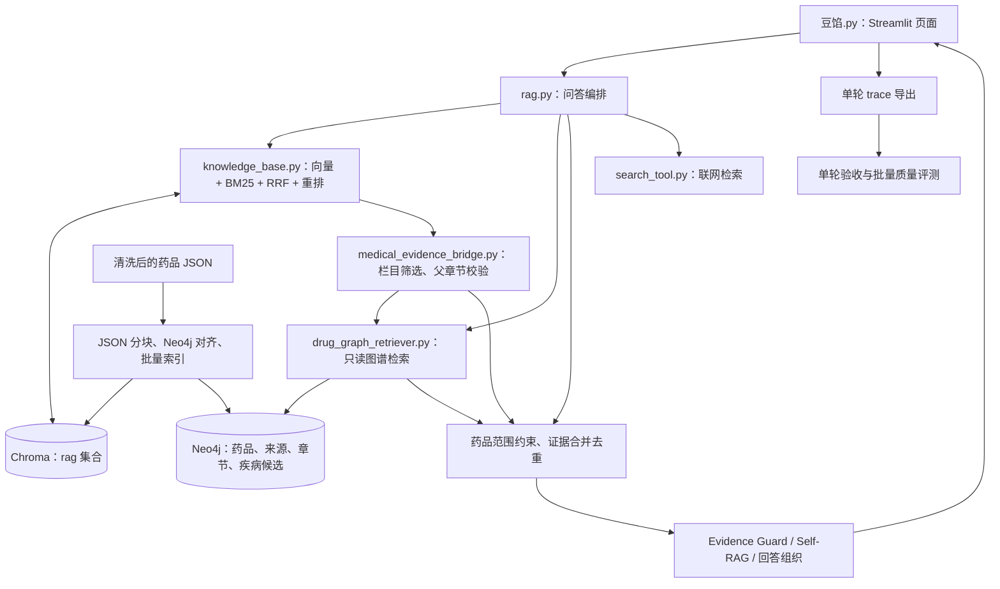

# 项目架构与文件功能说明

更新日期：2026-10-31（Asia/Shanghai）。本文依据当前工作区的实际文件、源码导入关系和已保存报告编写；Chroma 数量额外通过本地 SQLite 只读查询核对。本文不是 Neo4j、模型服务或网页端的实时联调验收报告。

项目根目录：`E:\VsCode_Project\DockerTest_Agent\RAG_project`。

## 1. 项目用途与架构概览

这是一个以 Streamlit 为界面的医疗 Hybrid GraphRAG 问答项目，同时保留普通文档知识库和联网问答能力。当前业务代码集中在根目录下的 `data/`，并非只有数据文件放在这里。

核心职责分为四部分：

1. **在线问答**：根据问题检索 Neo4j 与 Chroma，筛选药品和栏目，核验来源，组织带引用的回答。
2. **知识入库**：从清洗后的药品 JSON 分块，核对 Neo4j 原文，再分批调用 Embedding 写入 Chroma。
3. **图谱构建**：清洗药名，保存药品、来源、章节与切块，抽取药品—疾病候选和相关评估信息。
4. **质量评测**：检查索引完整性、检索命中、单轮回答的证据引用，以及一批问答的工程和人工审核结果。



图中“批量索引 → Neo4j”表示只读原文核验；图谱写入由 `kg/` 下的专用构建、导入与维护命令负责。不同问答模式与问题类型会走不同分支，不是每次回答都依次执行全部模块。

## 2. 目录结构

以下是架构目录树。`…` 表示同类文件在后面的功能表中说明，并非文件丢失；实验 CSV、JSONL 和历史报告不逐个展开。

```text
RAG_project/
├─ RAG知识库/                         # 原有计算机课程 Markdown 资料
│  ├─ 数据结构.md
│  ├─ 机器学习.md
│  ├─ 神经网络与深度学习.md
│  └─ 计算机网络.md
└─ data/                              # 应用代码、数据和工具的主要工作目录
   ├─ 项目架构与文件功能说明.md         # 本文
   ├─ 豆馅.py                         # 主页面入口
   ├─ rag.py                          # 问答主流程
   ├─ knowledge_base.py               # 通用文档入库与混合检索
   ├─ drug_graph_retriever.py          # Neo4j 在线只读检索
   ├─ evidence_guard.py               # 回答前的证据充分性审核
   ├─ self_rag_retry.py                # 证据不足时的受限补检
   ├─ medical_*.py                    # 医疗证据、入库、扩容与评测模块
   ├─ graph_answer_view.py            # 疾病候选关系展示
   ├─ search_tool.py                  # 联网搜索
   ├─ query_planner.py                # 保留的通用问题规则规划器
   ├─ vector_stores.py                # Chroma 基础封装
   ├─ app_file_uploader.py            # 独立文档上传页面
   ├─ chat_store.py                   # 当前页面的 SQLite 会话存储
   ├─ file_history_store.py           # 后端模型消息历史
   ├─ conversation_store.py           # 另一版会话存储实现
   ├─ config_data.py                  # Chroma 路径、集合名、通用切块参数
   ├─ .env                            # 本机模型及数据库环境配置
   ├─ .gitignore                      # Git 忽略规则
   ├─ diagnose_chroma.py              # Chroma 只读诊断
   ├─ benchmark_v26.py                # 跨问题问答回归工具
   ├─ guard_ab_probe.py               # Evidence Guard 提示词对照工具
   ├─ evaluate_holdout.py             # 候选关系独立集评估
   ├─ preview_query_plan.py           # 问题规划预览
   ├─ seed_medical_chroma.py           # 早期 Neo4j → Chroma 小规模试点
   ├─ docker-compose.drugkg-clean-v2.yml
   ├─ requirements-kg.txt
   ├─ requirements-drugkg-import.txt
   ├─ 检查Neo4j原文.cypher
   ├─ README_V116_验收与操作指南.md
   ├─ README_V117_质量基线执行指南.md
   ├─ 使用说明_证据充分性V1.txt
   ├─ 使用说明_SelfRAG_V1.5.txt
   ├─ data/
   │  ├─ chat_history.sqlite3          # ChatStore 默认页面会话数据库
   │  └─ raw/drug_db/MedGraphRAG-Drug-DB/
   │     ├─ drug_db_v2_cleaned.json    # 清洗后的主药品数据
   │     ├─ drug_db_v2.json            # 早期清洗版本
   │     ├─ drug_db.json               # 原始药品说明书与相互作用
   │     ├─ medical.json               # 疾病百科 JSONL
   │     ├─ drug.json                  # 另一份药品结构化资料 JSONL
   │     ├─ drug_categories_*.json     # 中药、化学药分类映射
   │     ├─ drug_db_v2_name_repair_report.json
   │     ├─ README.md / NOTICE.md / LICENSE
   │     └─ .git/                     # 原始数据仓库自身的版本记录
   ├─ chroma_db/
   │  ├─ chroma.sqlite3               # Chroma 集合、文档和元数据等
   │  ├─ <UUID>/                     # 向量索引文件
   │  └─ knowledge_graph_*.sqlite3    # 现存辅助文件，非 Neo4j 服务本体
   ├─ chat_history/                   # 按 session_id 保存的后端消息历史
   ├─ kg/                            # 图谱构建、导入、审核和维护代码
   ├─ kg_output/                     # 基础/历史图谱输出及报告
   ├─ kg_output_clean_v2/            # 清洗版图谱与候选、试验输出
   ├─ kg_output_clean_v2_import_fixed/ # 导入用快照及已保存的验证结果
   ├─ configs/                       # 关系抽取工程基线冻结配置
   ├─ prompts/                       # 关系抽取和语义审核提示词
   ├─ expansion_manifests/            # round_01～round_06 固定扩容名单
   ├─ medical_bulk_state.sqlite3      # 医疗增量入库检查点
   ├─ medical_bulk_*.json             # 已执行批次的历史导入报告
   ├─ medical_kb_audit_v113.json       # 某次知识库审计快照
   ├─ evaluation_questions_v117.jsonl # 问答质量基线题库
   ├─ retrieval_eval_*.jsonl           # 检索命中测试题
   ├─ medical_traces_v117/            # 页面导出的真实单轮问答 trace
   ├─ medical_campaign_v117/          # 工程评测汇总、清单和人工审核表
   ├─ sample_synthetic_v116*.json      # 人工模拟验收输入及结果
   ├─ reports/                       # 各阶段构建、质量与校验报告
   ├─ review/                        # 关系抽取的人工盲审 CSV
   ├─ protocol/                      # 人工标注规范
   ├─ scripts/                       # 冻结、重试合并和评测辅助脚本
   ├─ queries/                       # Neo4j 只读查询示例
   ├─ docs/                          # 图谱、同步维护和文件整理说明
   ├─ demo/                          # 小样本演示数据和报告
   ├─ support/                       # 历史辅助脚本副本
   ├─ tests/                         # 单元测试、离线集成与回归测试
   ├─ LOCAL_VALIDATION.json           # 历史候选接入验证记录
   ├─ phase2_validation_summary.json  # 历史研究评测流程验证记录
   ├─ preflight_real_clean_v2.json    # 图谱导入预检结果
   ├─ sampling_manifest.json          # 开发集与独立样本抽样记录
   └─ __pycache__/                   # Python 自动生成的缓存
```

注意：`data/data/` 是当前项目实际存在的嵌套目录。以外层 `data/` 为工作目录时，主原始数据路径是 `data\raw\drug_db\MedGraphRAG-Drug-DB\drug_db_v2_cleaned.json`。

## 3. 在线问答文件

### 3.1 入口、检索和回答编排

| 文件 | 功能与主要内容 | 在项目中的位置 |
| --- | --- | --- |
| `豆馅.py` | Streamlit 聊天界面；会话切换、流式回答、计时、检索过程与证据卡展示、单轮验收 JSON 下载。 | 主程序入口，调用 `RagService`。 |
| `rag.py` | 定义 `RagService` 和 `.chain.stream()` / `.invoke()`；负责模式路由、问题分解、Neo4j 与 Chroma 检索、证据筛选合并、审核、补检、回答和 trace。部分多药品多栏目问题走原文组织分支。 | 在线问答编排核心。 |
| `knowledge_base.py` | `KnowledgeBaseService`：普通文档结构切分、稳定标识与增量入库；读取 Chroma 文档建立内存 BM25；向量与 BM25 融合；Qwen Reranker 重排。 | Chroma 与通用文档知识库核心。 |
| `drug_graph_retriever.py` | `DrugGraphRetriever`：药品/疾病识别、疾病提及候选查询、说明书栏目查询、多药品相关资料查询，以及按三个来源 ID 精确读取父章节。 | 在线 Neo4j 只读访问层。 |
| `evidence_guard.py` | 拆分必须回答的问题方面；审核证据覆盖和引文真实性，形成证据充分、部分充分或应拒答的结果。 | 生成前证据审核。 |
| `self_rag_retry.py` | 首轮证据不足时生成补检问题，执行有数量限制的补检与复审；不无限循环。 | 受限检索纠错。 |
| `search_tool.py` | 调用百炼 Qwen Responses 联网检索，解析真实 `web_search_call` 与来源，供联网模式和相关自动路由使用。 | 外部实时信息来源。 |
| `graph_answer_view.py` | 将 DiseaseCandidate 等候选提及组织成可读回答，显示原文、来源和未核验状态。 | 候选关系专用展示。 |
| `vector_stores.py` | `VectorStoreService`：按配置初始化 Chroma，提供基础向量检索器接口。 | 较早的通用向量封装；当前混合检索主要在 `knowledge_base.py`。 |
| `query_planner.py` | `plan_two_layer_aspects()`：针对卷积层、池化层等双方面问题的规则规划器。 | 保留的通用知识库辅助模块；当前 `rag.py` 还有自身的问题规划逻辑。 |
| `app_file_uploader.py` | 独立 Streamlit 文档上传页；解析 TXT、MD、PDF、DOCX 后调用 `upload_by_str()`。 | 普通知识库文档导入入口，不等同于医疗 JSON 精准入库管线。 |

### 3.2 医疗证据与回答处理

| 文件 | 功能与主要内容 |
| --- | --- |
| `medical_entity_gate.py` | 按用户明确点名的药品约束文档与证据范围；支持多药对比，减少“同一疾病导致其他药品混入引用”。疾病开放式问题不强制推断唯一药品。 |
| `medical_evidence_bridge.py` | 按问题筛选说明书栏目；回查 Neo4j 父章节，核对来源、SHA256 和字符坐标；拒绝来源不匹配的新版 JSON Chunk；去掉与已核验子块重复的 Neo4j 父章节证据。 |
| `medical_overview_answer.py` | 对疾病相关多药品、多栏目问题，按实际候选药品和实际原文组织概览；列出已有与缺失栏目，减少生成过程中遗漏药品或栏目。 |
| `medical_answer_quality.py` | 清理空 Markdown 列表、无效本地引用等显示问题；流式输出过滤；按来源组织紧凑参考资料。 |
| `medical_retrieval_status.py` | 统一统计取回、实体筛选、原文核验和去重后的数量；供后端 trace 与页面使用相同口径。 |
| `medical_quality_acceptance.py` | 构造页面导出的单轮验收数据；离线检查引用编号、同源章节重复、药品范围、栏目覆盖和回答一致性。它被页面直接导入，不只是一个可独立删除的测试脚本。 |

### 3.3 会话、配置与基础设施

| 文件或目录 | 功能与主要内容 |
| --- | --- |
| `chat_store.py` | 当前页面直接使用的 `ChatStore`；保存会话、消息、trace 及选中会话。默认文件为外层 `data/` 下的 `data/chat_history.sqlite3`，可通过 `DOUXIAN_CHAT_DB` 调整。 |
| `file_history_store.py` | 按 `session_id` 读写 LangChain 消息历史，默认位于外层 `data/chat_history/`；与页面会话存储用途不同。 |
| `conversation_store.py` | 另一版 SQLite 会话持久化与旧历史迁移实现，默认 `chat_history/conversations.sqlite3`；当前 `豆馅.py` 直接使用的是 `chat_store.py`。 |
| `config_data.py` | 当前 `collection_name="rag"`、`persist_directory="./chroma_db"`；通用切块上限 1000、重叠 200、分隔符与结构切分阈值。 |
| `.env` | 本机配置：模型名、服务端点、API Key、Neo4j 连接信息，以及可选功能参数。本文不记录具体凭据。 |
| `docker-compose.drugkg-clean-v2.yml` | 可选的独立 Neo4j 5.26 容器定义；本机端口映射 7475/7688，使用独立命名数据卷。该文件存在不代表当前应用一定连接此实例。 |
| `requirements-kg.txt`、`requirements-drugkg-import.txt` | 当前内容是 Neo4j Driver 和 python-dotenv 依赖；不是 Streamlit、LangChain、Chroma 等整套应用的完整依赖清单。 |

相对路径依赖进程工作目录，建议从外层 `data/` 启动应用。不能因为页面消息和模型历史都叫“会话”就将两类存储合并理解。

## 4. 医疗 JSON 入库与扩容文件

| 文件 | 功能与主要内容 | 使用阶段 |
| --- | --- | --- |
| `medical_json_chunker.py` | 按 JSON 字段、数组条目、句末和编号边界分块；保留原文，标记强制截断；定位 Neo4j Section 中的精确片段，生成稳定 Chunk ID、正文与溯源元数据。 | 公共切分与原文对齐基础。 |
| `medical_json_index.py` | 单药品预览、Neo4j 原文匹配和少量 Chroma 写入。 | 早期试点与单药排错。 |
| `medical_json_bulk_index.py` | 多药品增量索引：来源核验、已有 Chunk 复用、冲突拒绝、Embedding 数量/字符预算、失败记录与断点续跑。 | 实际批量入库执行器。 |
| `medical_expand_batch.py` | 按固定批次名单调度已有批量索引器，支持 `preview`、`verify`、`apply`、`status`。相同批次重复执行仍限定在同一名单。 | 当前固定名单扩容入口。 |
| `seed_medical_chroma.py` | 从 Neo4j 读取说明书栏目、组织文档，再写入现有 Chroma。 | 早期兼容试点；不是当前 JSON 结构感知入库的主入口。 |
| `expansion_manifests/round_01.json`～`round_06.json` | 保存固定药品名单、批次信息和扩容参数。 | 保证扩容范围可复现。 |
| `medical_bulk_state.sqlite3` | `manifest` 保存源快照、参数及目标身份；`drug_progress` 保存逐药 `done`、`no_chunks`、失败等状态。 | 增量导入检查点，不是向量数据库。 |
| `medical_bulk_last_report.json` | 早期一批新增 82 条、执行后共 88 条的报告。 | 历史快照，不能当实时总数。 |
| `medical_bulk_expansion_round_01.json` | 固定名单第 1 批新增 225 条、执行后共 313 条的报告。 | 扩容历史与追踪。 |

当前医疗 JSON 默认处理五类栏目：`indication`（适应症）、`contraindications`（禁忌）、`adverse_reactions`（不良反应）、`warnings`（注意事项）、`drug_interactions`（药物相互作用）。切分器也定义了用法用量和成分等字段，但它们不在默认五字段集合中。

默认预览、原文核验和实际写入是不同操作。医疗批量工具实际写入需要 `--apply --allow-cloud-embedding`；此时会调用配置的 Embedding 服务并写入 Chroma。日常问答不会自动对原始全库执行向量入库。

## 5. `kg/` 图谱模块

| 文件 | 功能与主要内容 |
| --- | --- |
| `__init__.py` | 图谱 Python 包入口。 |
| `profile.py` | 对原始数据做规模、字段覆盖、占位文本、相互作用与来源质量分析。 |
| `clean_names.py` | 保守修复药名格式、重复和括号等问题，保留原名与来源，不改写医学正文。 |
| `build.py` | 将药品 JSON 转成可溯源的图谱 JSONL；生成药品、来源记录、章节、切块、名称提及与相互作用候选。图谱切块默认 800 字符、重叠 90。 |
| `prepare_cleaned_v2.py` | 基于已清洗的 v2 数据构建快照，保留额外来源记录，输出别名候选和名称审计信息。 |
| `validate.py` | 校验 JSONL ID、外键、来源哈希、章节和片段字符坐标的一致性。 |
| `neo4j_import.py` | 基础图谱导入器；按依赖顺序建节点和边；默认预览，`--apply` 执行写入。 |
| `neo4j_drug_graph.py` | 清洗版图谱及疾病候选的预检、导入、隔离检查和导入后验证；保存候选状态，不推断已确认治疗关系。 |
| `neo4j_existing_candidates.py` | 向已有清洗图谱追加 DiseaseTerm、DiseaseCandidate、ModelAssessment 及溯源边；先核对基础节点和精确证据，不重导基础正文。 |
| `import_cleaned_aliases.py` | 导入 DrugAlias 候选映射；不直接认定为已确认 `SAME_AS`。 |
| `disease_stage3.py` | 读取疾病词表，从适应症章节提取疾病候选；支持人工审核声明及对应导入流程。 |
| `review_indications.py` | 对人工标注的药品—疾病提及核对适应症原文与引用，输出受原文支持的声明数据。 |
| `review_context_v2.py` | 审核带条件、限定语与语境的关系声明，导出或导入有溯源的研究声明。 |
| `indication_v3.py` | 规则与可选模型结合的适应症语义分类，输出机器提议及评测结果。 |
| `indication_v31.py` | 强化疾病目标、角色、否定与条件的语义判断；仍只输出提议，不修改人工标签或数据库。 |
| `indication_v31_checkpoint.py` | V3.1 的带指纹、检查点和断点恢复的推理版本，避免重复处理已完成样本。 |
| `export_rag_docs.py` | 从图谱 `chunks.jsonl` 导出独立的 `{id,text,metadata}` 文档 JSONL；可选栏目并过滤占位文本，本身不做 Embedding 或 Chroma 入库。 |
| `sync_cleaned_v2.py` | 对照新旧快照生成同步计划，处理旧来源与旧边等残留；属于数据库维护流程。 |
| `repair_residuals.py` | 用确定性 ID 排查和修复同步后的旧节点、旧候选等残留；默认只读，实际修复需专用参数。 |

`support/build.py` 与 `support/prepare_cleaned_v2.py` 是保留的历史辅助副本。当前图谱包入口在 `kg/`，不应仅凭同名就认为两份脚本都是当前主实现。

## 6. 数据文件与图谱结构

### 6.1 原始数据

目录：`data/raw/drug_db/MedGraphRAG-Drug-DB/`（相对本文所在目录）。

| 文件 | 内容与作用 |
| --- | --- |
| `drug_db.json` | 原始药品说明书字段与相互作用记录；用于追溯和版本对照。 |
| `drug_db_v2.json` | 较早清洗的药品名称与结构化说明书版本。 |
| `drug_db_v2_cleaned.json` | 当前清洗主输入；包含药品、相互作用、额外来源记录、原名、别名和重定向等。当前构建快照包含 11,953 个药品名称、11,960 条来源记录。 |
| `drug_db_v2_name_repair_report.json` | 名称修改、合并、隔离及相互作用调整等审计记录。 |
| `medical.json` | 8,807 条疾病百科 JSONL；含疾病名称、简介、病因、预防、症状、检查等。疾病词表可用于候选匹配，不表示这些正文已完成向量入库。 |
| `drug.json` | 17,496 条另一来源的结构化药品等资料 JSONL；字段体系与主药品 JSON 不同，不能直接套用同一入库 Schema。 |
| `drug_categories_chinese.json`、`drug_categories_western.json` | 中药和化学药用途分类映射。 |
| `README.md`、`NOTICE.md`、`LICENSE` | 数据结构、来源说明及许可相关文件。 |

根目录 `RAG知识库/` 的四份计算机课程 Markdown 是原有通用资料。文件存在不等于已导入当前医疗 Chroma 集合。

### 6.2 图谱产物

`kg_output/`、`kg_output_clean_v2/`、`kg_output_clean_v2_import_fixed/` 保存不同构建或导入用途的输出。部分大文件内容重复，**不能按目录数量累加为多份医疗知识**；历史报告也可能对应不同版本。

| 文件或文件族 | 内容与作用 |
| --- | --- |
| `drugs.jsonl` | Drug 药品名称级实体，包含确定性 ID、名称、原名或别名信息。 |
| `source_records.jsonl` | SourceRecord 来源记录；保存药品 ID、URL、原始记录哈希、快照哈希及来源状态。 |
| `sections.jsonl` | Section 说明书章节；保存所属来源、栏目、全文和是否为占位内容。 |
| `chunks.jsonl` | Chunk 图谱切块；保存所属 Section、栏目、片段全文与起止位置。 |
| `mentions.jsonl` | NameMention 名称提及，服务于相互作用候选等端点表达。 |
| `interaction_candidates.jsonl` | 未经医学验证的药物相互作用候选及其证据，不等于已确认的药物相互作用事实。 |
| `drug_aliases.jsonl` | DrugAlias 别名候选。 |
| `name_redirects_audit.jsonl`、`name_provenance_audit.jsonl` | 名称重定向与名称来源审计。 |
| `build_report.json` | 输入快照、Schema、参数、节点数量、字段数量等构建信息。 |
| `disease_candidates*.csv` / `*.report.json` | 适应症中的疾病提及候选、原文坐标、语境标记及提取统计。 |
| `pilot_*.csv` / `*.json` | 小样本分类、重试、审核与合并实验记录。 |
| `independent_300*` | 独立样本、去标签的推理输入、模型预测及检查点。 |
| `v31_*ids.csv`、`v31_*diagnostics.csv` | 失败、重试、优先复核等样本清单与诊断。 |
| `pilot_review_v2/` | 早期审核导出的 DiseaseTerm、IndicationClaim 及审核报告。 |
| `sync_*.json`、`residual_repair_*.json` | 图谱同步和残留修复的计划或执行结果。 |
| `kg_output_clean_v2_import_fixed/attach_candidates_result.json` | 已保存的追加候选验证结果：基础节点、候选和评估数量及是否执行写入；不是实时数据库查询。 |

基础正文溯源链：

```text
Drug（药品）
  └─ HAS_RECORD → SourceRecord（来源记录）
       └─ HAS_SECTION → Section（如禁忌、不良反应章节）
            └─ HAS_CHUNK → Chunk（图谱正文切块）
```

疾病提及候选链：

```text
Drug ─ HAS_CANDIDATE → DiseaseCandidate ─ MENTIONS_TERM → DiseaseTerm
                            ├─ SUPPORTED_BY → Section
                            └─ FROM_RECORD → SourceRecord
ModelAssessment ─ ASSESSES → DiseaseCandidate
```

审核声明类节点还可能用 `SUBJECT` 指向药品、`OBJECT` 指向疾病或症状，并用 `SUPPORTED_BY` 指向证据。`SUBJECT` / `OBJECT` 仅表示声明的主体和客体，实际关系语义及核验状态要看声明属性。

### 6.3 Chroma 中的医疗子块

新版医疗文档通常包含“药品、栏目、资料状态、证据原文”前缀和正文，重要元数据如下：

| 字段 | 用途 |
| --- | --- |
| `chunk_id`、`doc_id` | 文档身份、去重和增量复用。 |
| `data_origin` | 新版 JSON 管线标记为 `json_matched_to_neo4j_section`。 |
| `drug_name`、`section_field`、`section_path` | 药品范围、栏目筛选、展示和引用。 |
| `drug_id`、`record_id`、`section_id` | 精确定位 Neo4j 父章节。 |
| `source_url`、`source_status` | 来源地址及来源状态。 |
| `quote_start`、`quote_end` | 子块证据在父章节中的字符区间。 |
| `section_sha256`、`content_sha256` | 父章节与子块正文一致性校验。 |
| `json_filename`、`json_path` | 回溯原 JSON 文件和字段/条目位置。 |
| `forced_cut`、`chunk_index`、`chunk_total` | 切分质量与片段顺序。 |

图谱旧切块与新版 JSON 向量子块不是一套切分结果：图谱构建默认 800/90；新版 JSON 管线按字段与条目切分，采用相应运行参数，通常为 1000/200。不能把 `chunks.jsonl` 行数直接当成当前 Chroma 向量数量。

## 7. 评测、诊断与操作说明

### 7.1 工具文件

| 文件 | 检查或评测什么 | 输入与产物 |
| --- | --- | --- |
| `diagnose_chroma.py` | 配置路径、集合和记录数；以 SQLite 只读方式检查。 | 读取配置和本地数据库，输出诊断。 |
| `medical_chroma_acceptance.py` | 索引正文、元数据、重复 ID、强制截断；可抽样回查父章节。 | 现有 Chroma；可选 Neo4j。 |
| `medical_hybrid_probe.py` | 单问题 BM25 或 Hybrid+Rerank 命中，以及 Neo4j 精确溯源。 | 一个问题，输出命中与回溯结果。 |
| `medical_retrieval_eval.py` | 目标药品/栏目命中和跨药品污染；可比较实体约束前后。 | `retrieval_eval_*.jsonl`；输出检索统计，不是医学正确率。 |
| `medical_eval_workbench.py` | `audit` 审计索引覆盖；`draft` 生成待标注题；`score` 按人工 Gold Section ID 计算检索指标；`compare` 比较评测报告。 | 索引、人工审核 CSV 与检索报告。自动建议章节不能直接充当人工金标准。 |
| `medical_quality_acceptance.py` | 单轮回答的引用、证据重复、药品范围及栏目一致性。 | 页面导出 JSON；输出 PASS/WARN/FAIL 等工程报告。 |
| `medical_quality_campaign.py` | 批量收集单轮导出、生成工程汇总与人工审核表；人工填写后生成质量统计。 | `medical_traces_v117/` → `medical_campaign_v117/`。 |
| `benchmark_v26.py` | 跨问题回归；默认列用例，指定运行后测试真实问答链。 | 回归用例与结果报告；实际运行可能调用模型。 |
| `guard_ab_probe.py` | 用相同证据对照不同 Evidence Guard 提示词。 | 已有检索证据；实际对照调用模型。 |
| `evaluate_holdout.py` | 对完整人工标注的关系候选独立集计算分层精度等。 | 独立评估 CSV；未完成标注不能当成完整精度结论。 |
| `preview_query_plan.py` | 预览典型问题的分解与检索规划。 | 示例问题与规划输出。 |
| `scripts/v31_study_gate.py` | 冻结关系抽取工程基线、准备盲审表与独立评测工作流。 | 配置、样本、审核表和评测产物。 |
| `scripts/merge_v31_retries.py` | 合并校验通过的重试结果，保留原来已有效的行。 | 多轮 CSV 与合并报告。 |

### 7.2 评测数据、报告与说明目录

| 路径 | 内容与作用 |
| --- | --- |
| `evaluation_questions_v117.jsonl` | 用于形成问答质量基线的问题集合。 |
| `retrieval_eval_seed.jsonl`、`retrieval_eval_expansion_round01.jsonl` | 初始与扩容后的轻量检索测试题。 |
| `medical_traces_v117/medical_trace_*.json` | 页面导出的问题、回答、证据和检索 trace。 |
| `medical_campaign_v117/engineering_manifest_v117.json` | 已收集样本的标识、工程检查与追溯清单。 |
| `medical_campaign_v117/engineering_overview_v117.md` | 一批问答的工程质量汇总，不是医学正确率报告。 |
| `medical_campaign_v117/manual_review_v117.csv` | 待人工审阅的证据支持、关系表达、医学安全和来源权威性表。 |
| `sample_synthetic_v116.json`、`sample_synthetic_v116_report.json` | 人工模拟的验收输入和结果；不能当成真实链路验收。 |
| `reports/` | 数据质量、构建、完整性、名称修复、语义分类与检查点等阶段报告；部分是历史版本。 |
| `configs/freeze_v31_engineering.json` | 模型、提示词、代码、源数据等冻结指纹，便于评测复现。 |
| `prompts/indication_semantic_review*.md` | 适应症语义抽取、目标锚定和检查点版本的提示词。 |
| `review/` | 21 条双审核表及 300 条独立盲审表等；与问答质量人工表用途不同。 |
| `protocol/人工盲审标注规范.md` | 关系候选人工标注的定义、步骤和规则。 |
| `sampling_manifest.json` | 样本选择、分层与开发/独立评测划分记录。 |
| `LOCAL_VALIDATION.json`、`phase2_validation_summary.json`、`preflight_real_clean_v2.json` | 不同阶段的本地校验、评测流程准备与图谱预检快照。 |
| `demo/` | 小规模演示词表、样例与 smoke 报告，不能当全库统计。 |
| `queries/drugkg_readonly_examples.cypher`、`检查Neo4j原文.cypher` | Neo4j 只读查询、字段检查和原文排错示例。 |
| `README_V116_验收与操作指南.md` | 页面单轮 trace 导出、跨库去重和回答一致性验收操作。 |
| `README_V117_质量基线执行指南.md` | 批量工程基线、人工审核及评分流程。 |
| `docs/图谱实体与关系说明.md` | 图谱实体、属性、关系和数据解释；其中部分数量是旧快照，应对照当前构建报告。 |
| `docs/README_先看我.md` | 早期图谱模块上手和流程说明。 |
| `docs/README_清洗版V2同步.md`、`docs/README_残留节点修复.md` | 清洗快照同步与残留修复的维护操作。 |
| `docs/README_同步操作.md` | 较早同步说明，部分命令名称应以现存脚本为准。 |
| `docs/medical文件用途与清理建议_2026-10-30.md` | medical 模块依赖、用途和整理建议。 |
| `docs/旧文件排查清单_2026-10-30.md` | 历史重复文件、归档候选和引用影响；不是已经执行清理的记录。 |
| `使用说明_证据充分性V1.txt`、`使用说明_SelfRAG_V1.5.txt` | Evidence Guard 和补检机制的操作及行为说明。 |

### 7.3 测试目录

`tests/` 主要是标准库 unittest、纯函数和模拟数据库/模型的离线测试。测试通过只证明相应代码行为，不自动证明真实模型效果、Neo4j 在线可用性或医学结论正确。

| 测试文件或文件族 | 覆盖范围 |
| --- | --- |
| `test_graph_retriever.py`、`test_graph_answer_view.py`、`test_unified_kb.py` | 图谱检索、候选展示、Neo4j 与 Chroma 联合检索。 |
| `test_seed_medical.py`、`test_medical_json.py` | 早期入库、JSON 切分、来源匹配与预览/写入边界。 |
| `test_medical_bulk.py`、`test_expand_batches.py` | 批量导入、去重、预算、断点恢复、固定名单扩容。 |
| `test_medical_parent_integration.py`、`test_medical_acceptance.py` | 父章节精确回溯、元数据与正文校验、核验失败处理。 |
| `test_medical_entity_gate.py`、`test_medical_answer_quality.py` | 药品范围约束、引用整理、显示和输出处理。 |
| `test_v110_graph_evidence.py`、`test_v111_status.py` | 图谱证据处理和各检索阶段计数。 |
| `test_v114_multi_aspect.py`、`test_v115_source_overview.py` | 多方面、多药品、多栏目问答及原文概览。 |
| `test_v116_quality_acceptance.py`、`test_v117_campaign.py` | 单轮证据验收、批量工程汇总与人工审核流程。 |
| `test_neo4j_drug_graph.py`、`test_review_context_v2.py` | 图谱导入预检和带语境审核逻辑。 |
| `test_indication_v3.py`、`test_indication_v31.py`、`test_indication_v31_checkpoint.py` | 关系语义分类、目标锚定、参数校验及检查点。 |
| `test_v31_study_gate.py` | 工程基线冻结和独立评测约束。 |
| `__init__.py` | 测试包入口。 |

## 8. 关键数据流

### 8.1 图谱离线构建

```text
原始药品 JSON
  → 药名清洗 / 质量分析
  → kg.prepare_cleaned_v2 / kg.build
  → drugs / source_records / sections / chunks 等 JSONL
  → 完整性与证据坐标检查
  → 图谱导入器
  → Neo4j

疾病名称词表 + 适应症章节
  → 疾病提及候选
  → 可选规则 / 模型语义评估 / 人工审核
  → 候选或审核声明及其证据链
```

### 8.2 医疗向量增量入库

```text
expansion_manifests 固定名单（或直接指定药品）
  → medical_expand_batch / medical_json_bulk_index
  → 读取 drug_db_v2_cleaned.json
  → medical_json_chunker 按字段和条目切分
  → 只读 Neo4j 并精确定位 Section 原文
  → 已有 Chunk 复用 / 冲突检查 / 预算检查
  → DashScope Embedding
  → Chroma rag 集合
  → SQLite 检查点 + 本批 JSON 报告
```

### 8.3 在线医疗问答

```text
用户问题 → 豆馅.py → RagService
  ├─ Neo4j：药品 / 疾病候选 / 说明书相关章节
  └─ Chroma：向量召回 + 内存 BM25 + RRF + Qwen 重排
          → 药品和栏目筛选 → Neo4j 父章节精确回溯
  → 合并证据 → 药品范围约束 → 同源去重
  → 按问题类型选择：
       ├─ 候选关系说明
       ├─ 多药品、多栏目原文概览
       └─ Evidence Guard → 必要时 Self-RAG 补检 → 模型回答
  → 引用与来源整理 → 页面展示 → 保存消息及 trace
```

具体执行顺序和证据数量受模式、问题类型和运行配置影响。普通/联网问题有独立分支。

### 8.4 评测闭环

```text
页面导出单轮 trace
  → medical_quality_acceptance：单轮工程检查
  → medical_quality_campaign collect：批量汇总 + 人工审核表
  → 人工填写审核结果
  → medical_quality_campaign score：人工质量统计

Chroma 已入库资料
  → medical_eval_workbench draft：待标注检索题
  → 人工确认 Gold Section ID
  → score / compare：检索指标与不同配置对比
```

## 9. 当前实现状态与容易混淆的地方

1. **父章节回查已接入，父块上下文扩展尚未实现。** 新版 JSON 子块命中后，读取 Neo4j Section 全文用于来源、哈希和字符区间校验；核验通过后进入回答链的仍是子块正文，不会自动替换为父章节全文。这主要是为了避免部分旧 Section 跨字段内容混入回答。
2. **禁忌、不良反应、注意事项等不只有原始文件。** 它们已存在于说明书章节和在线栏目检索逻辑中，当前 Chroma 也已包含这些栏目。专门的“药品→禁忌人群/疾病”“药品→不良反应症状”等语义关系仍是另一项抽取工作。
3. **疾病候选、机器评估、文本审核和临床确认是不同状态。** 不能因为存在 DiseaseCandidate、SUBJECT/OBJECT 或原文精确匹配就认定为已确认治疗关系。
4. **BM25 当前是内存索引。** `knowledge_base.py` 从 Chroma 读取文档建立 BM25，不是已经部署的独立持久化搜索引擎。扩大数据规模后需要关注初始化时间和内存。
5. **历史报告不等于实时进度。** 如 `medical_bulk_last_report.json` 仍记录 88 条，而更新的扩容报告和本次 SQLite 只读核查均为 313 条；统计必须附上来源和日期。
6. **工程验收和医学质量评测分开。** PASS/WARN/FAIL 的引用与去重检查，不代表医学语义或权威说明书核验已通过。

截至本文更新时可核对的快照：

| 项目 | 数量或状态 | 依据与限制 |
| --- | --- | --- |
| 本地 Chroma `rag` | **313 条记录，69 个药品名称** | 本次对 `chroma.sqlite3` 的只读查询。 |
| 清洗版图谱构建 | 11,953 药品、11,960 来源、106,445 章节、107,787 图谱切块 | 保存的清洗版构建及验证报告，不是本次在线 Neo4j 查询。 |
| 疾病提及候选 | 19,685 条，附 60 条模型评估 | `attach_candidates_result.json` 历史验证报告。 |
| V1.17 工程评测汇总 | 18 个不同问题；PASS 2、WARN 16、FAIL 0 | 当前 `engineering_overview_v117.md`；只衡量工程证据和引用约束。 |

## 10. 常用入口与阅读顺序

从外层 `data/` 工作目录执行：

```powershell
Set-Location "E:\VsCode_Project\DockerTest_Agent\RAG_project\data"

# 启动聊天页面
streamlit run "豆馅.py"

# 仅检查本地 Chroma 配置与已有数量
python diagnose_chroma.py

# 固定扩容批次的预览；不执行实际 Embedding 入库
python medical_expand_batch.py --batch 1 --mode preview

# 对已有单轮导出做离线检查；文件名按实际导出修改
python medical_quality_acceptance.py --input "medical_traces_v117\medical_trace_001.json"
```

建议阅读顺序：

- **理解问答**：`豆馅.py` → `rag.py` → `knowledge_base.py` / `drug_graph_retriever.py` → `medical_evidence_bridge.py` / `medical_entity_gate.py` → `evidence_guard.py` / `self_rag_retry.py`。
- **理解入库**：`medical_expand_batch.py` → `medical_json_bulk_index.py` → `medical_json_chunker.py` → `expansion_manifests/` 和检查点结构。
- **理解图谱**：`kg/prepare_cleaned_v2.py` / `kg/build.py` → `kg/validate.py` → 相应 Neo4j 导入器 → 候选提取和审核模块。
- **理解质量评测**：[V1.16 操作指南](README_V116_验收与操作指南.md) → [V1.17 质量基线指南](README_V117_质量基线执行指南.md) → `medical_quality_acceptance.py` / `medical_quality_campaign.py`；检索指标另看 `medical_eval_workbench.py`。

维护本说明时，以实际源码导入、命令参数和数据库核查为准；新增、删除或归档文件后同步更新目录树及功能表。
